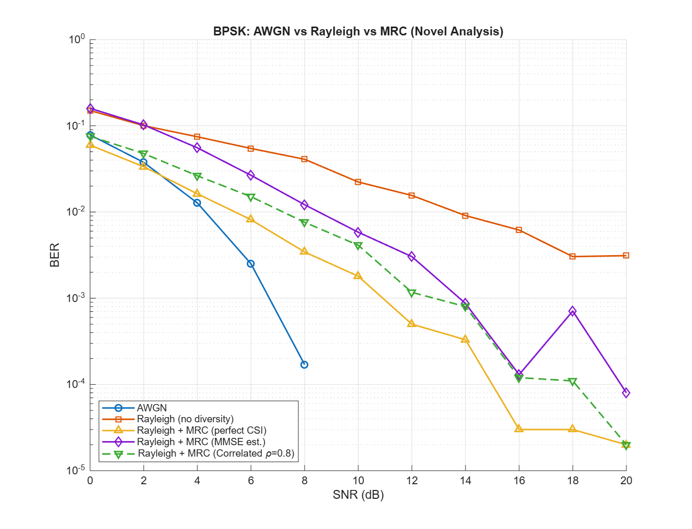

# Wireless Link Simulator (BPSK + MRC)

A MATLAB simulation of a BPSK communication link comparing AWGN, Rayleigh fading, and 2-branch Maximal-Ratio Combining (MRC). 

## Novel Analysis
Unlike standard textbook simulations, this project explores two realistic impairments:
1. **Imperfect Channel Estimation:** Using block fading with 10% pilot overhead and MMSE estimation.
2. **Spatial Correlation:** Placing antennas too close together (\(\rho = 0.8\)), which degrades the diversity gain.

## Results

*Notice how MMSE estimation closely tracks the Perfect CSI curve, while the correlated branch curve demonstrates why physical antenna spacing is critical.*

## How to Run
1. Open MATLAB.
2. Run `Wireless_Sim.m`.
3. The script will generate the SNR vs BER plot and save it as `ber_curves.png`.
